<h1 align="center">
  <br>
  
  <br>
  Amigo Secreto Geoje
  <br>
</h1>

<p align="center">
  Site de amigo secreto para um grupo de amigos que joga na Steam: o organizador cadastra o pessoal e sorteia, cada um recebe por e-mail quem tirou, abre o envelope no site e monta o presente pela lista de desejos da Steam da pessoa, com preços e promoções do dia.
</p>

<p align="center">
  
  
  
  
</p>

> As telas abaixo usam um grupo de demonstração, com nomes e e-mails fictícios.

---

## Telas

### Entrar
Cada participante entra com o e-mail em que recebeu o sorteio e a senha que criou pelo link do convite.

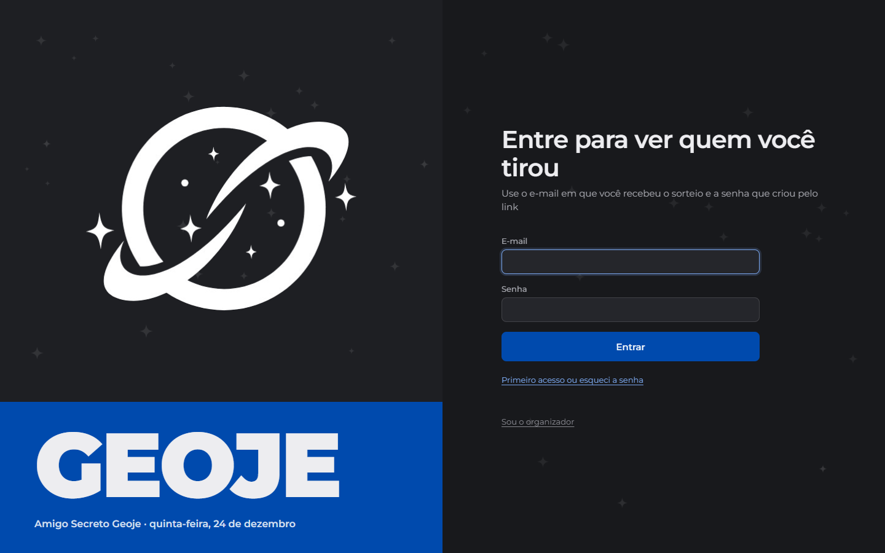

---

### Envelope
O nome de quem você tirou chega lacrado. Só aparece quando você abre o envelope, e dá para guardar de novo quando tiver alguém por perto.

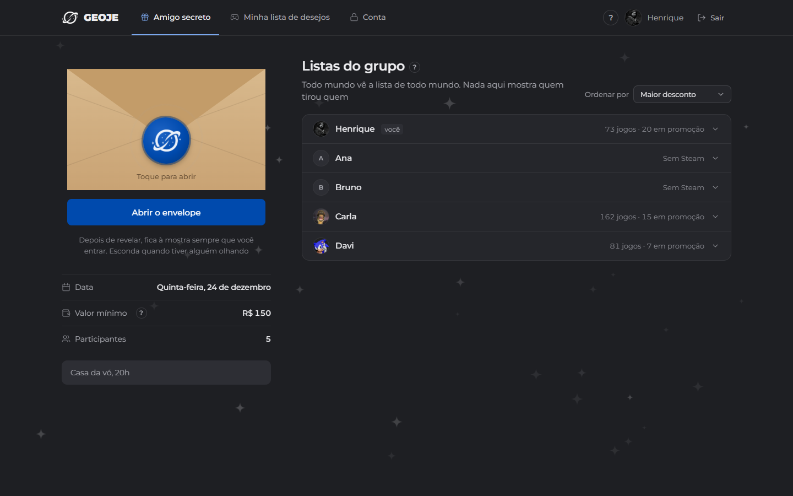

---

### Quem você tirou e a lista de desejos
Com o envelope aberto aparece a lista de desejos da pessoa na Steam, com preço de hoje, desconto e até quando vai a promoção. O + de cada capa separa o jogo como "talvez eu compre", e a barra no pé da tela soma até o valor mínimo.

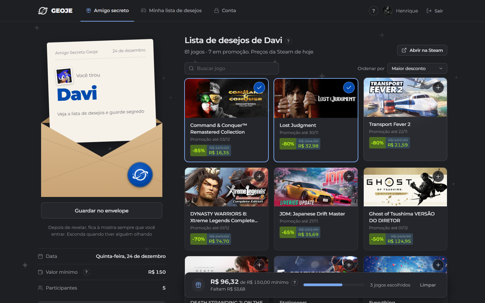

---

### Fora da lista
Busca em toda a loja da Steam para surpreender com um jogo que não está na lista de desejos. Entra na mesma soma e só você vê.

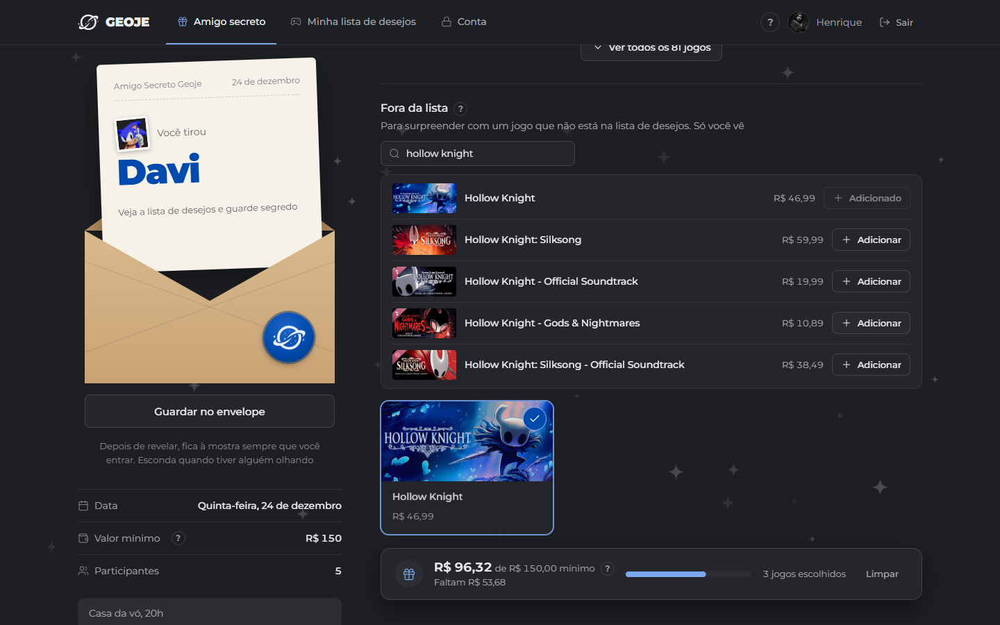

---

### Listas do grupo
As listas de desejos de todo mundo, sem mostrar quem tirou quem.

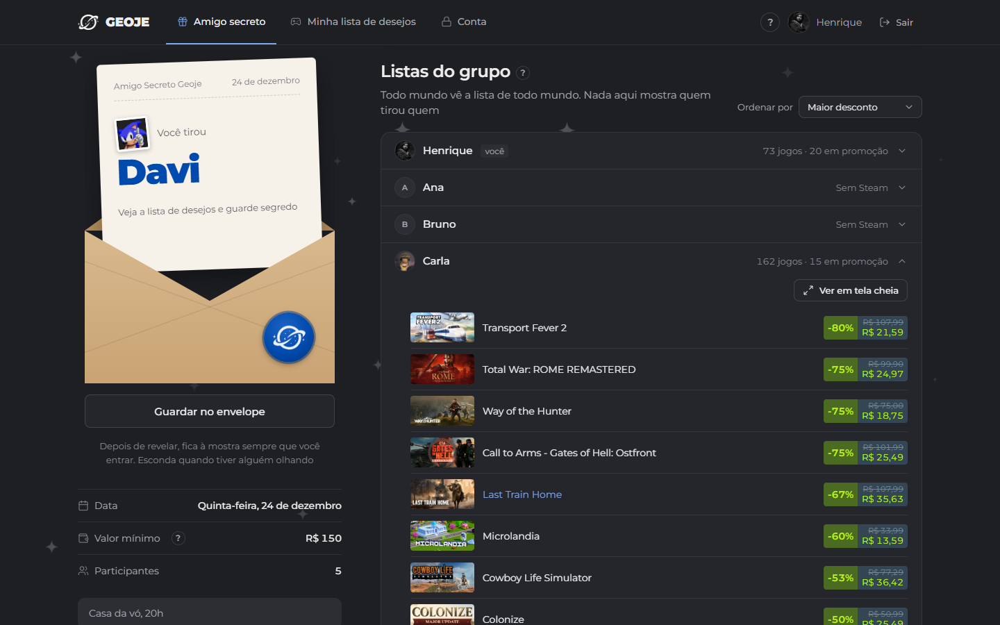

---

### Lista em tela cheia
A lista de qualquer pessoa do grupo com as capas grandes, busca e ordenação.

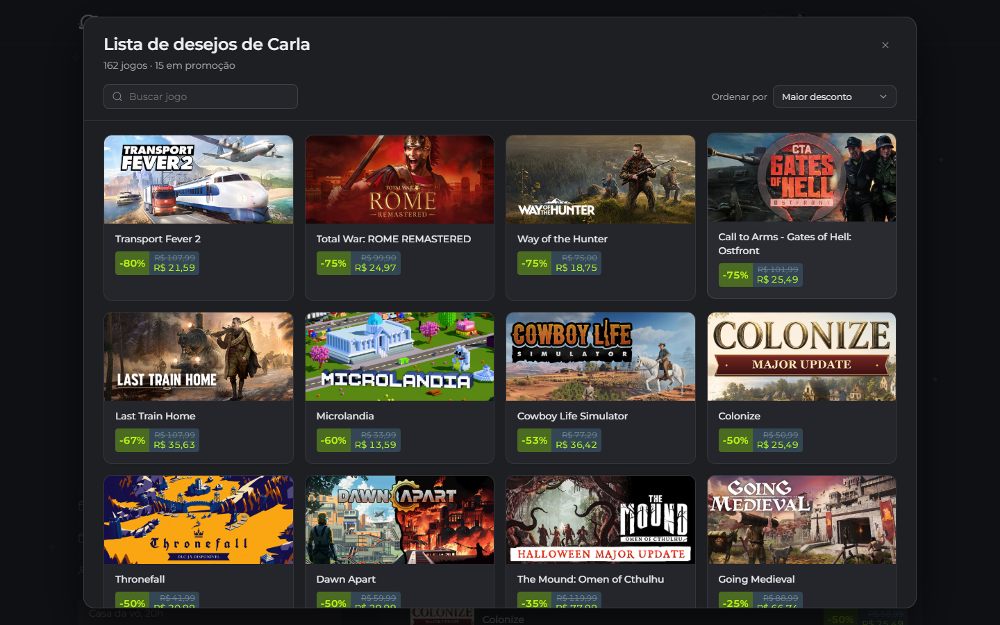

---

### Minha lista de desejos
Você informa o seu perfil da Steam e escolhe quais jogos o grupo pode ver. Ninguém fica sabendo o que foi escondido.

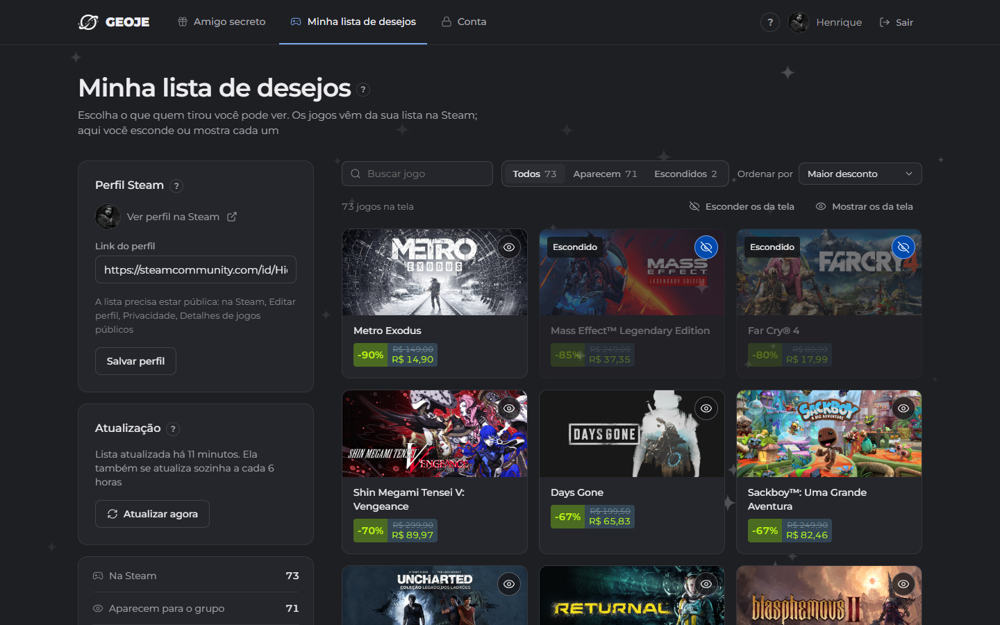

---

### Tour de boas-vindas
No primeiro acesso, um tour de 6 passos mostra onde fica cada coisa. O ? da barra repete o tour quando quiser.

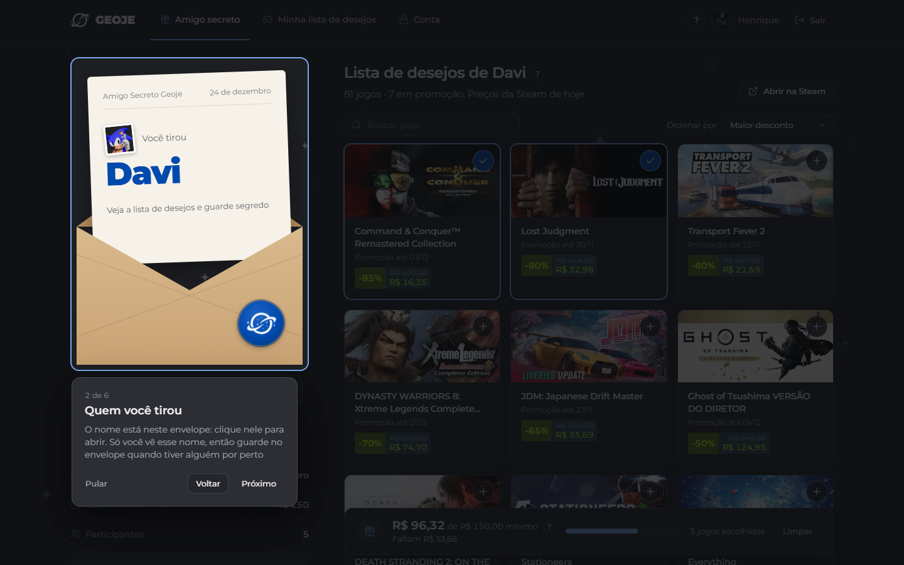

---

### Ajuda em cada parte
Cada funcionalidade tem um ? com uma explicação curta.

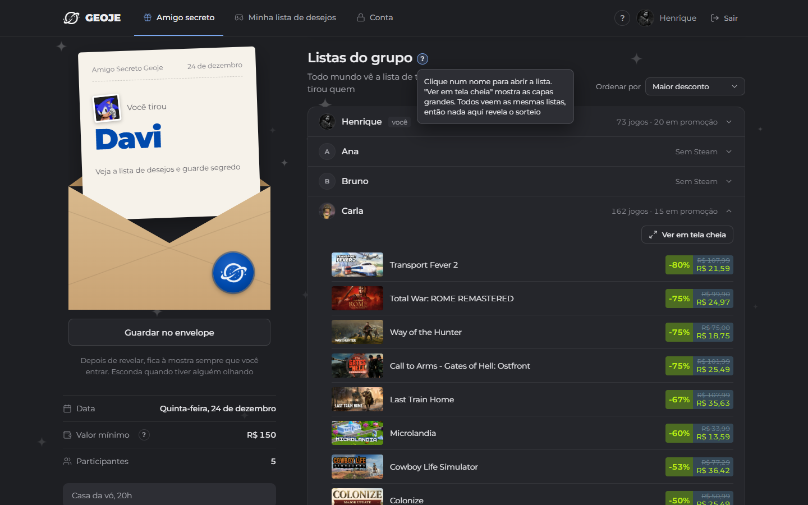

---

### Conta

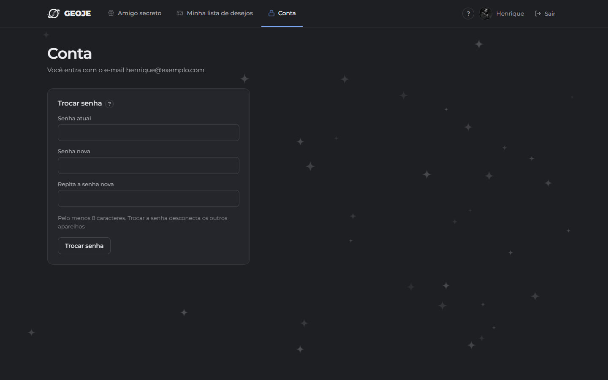

---

### Painel do organizador
Participantes, dados do evento e o sorteio. O painel não mostra quem tirou quem.

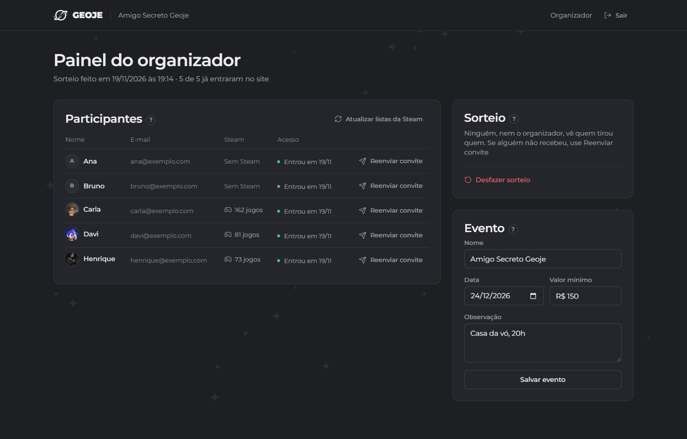

---

### No celular

<p align="center">
  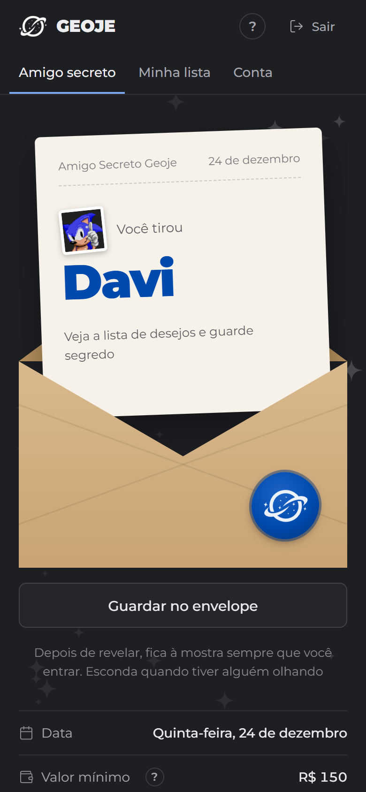
  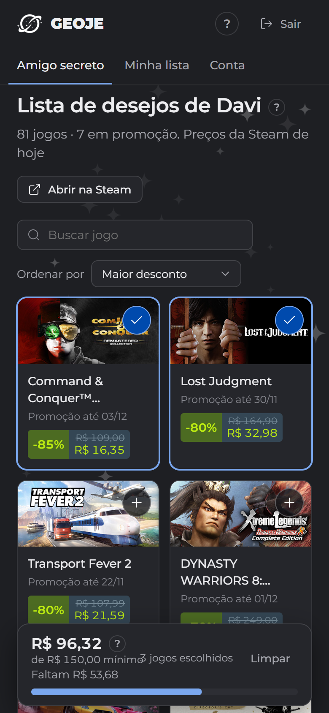
  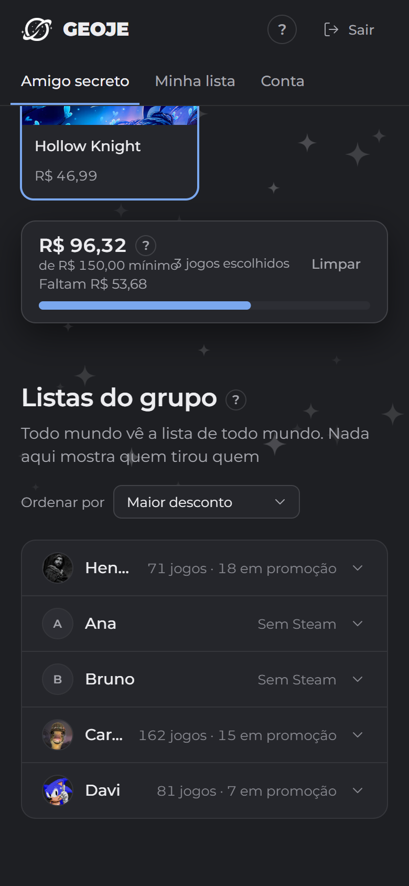
</p>

---

## Funcionalidades

### Sorteio
- Mínimo de 3 participantes; ninguém tira a si mesmo
- Ao sortear, cada pessoa recebe um e-mail com quem tirou e um link para criar a senha (vale 14 dias)
- **Reenviar convite** para quem não recebeu e aviso de quem ficou sem e-mail quando o envio falha no meio
- **Desfazer sorteio** para começar de novo (os links antigos param de valer)
- O painel do organizador não mostra os pares

### Envelope
- O nome sorteado fica lacrado até a pessoa abrir, com animação de abertura
- Depois de aberto, fica à mostra nos próximos acessos; "Guardar no envelope" esconde de novo

### Lista de desejos de quem você tirou
- Jogos da lista de desejos da Steam com capa, preço em reais, desconto e data do fim da promoção
- Busca por nome e ordenação (maior desconto, menor preço e outras)
- Lista longa começa recolhida, com "Ver todos os jogos"
- Atalho para abrir a lista na Steam

### Talvez eu compre
- O + das capas separa os jogos e a barra soma o total até o valor mínimo do evento
- Mostra quanto falta ou quanto passou do mínimo
- A seleção fica guardada na conta e só quem montou vê

### Fora da lista
- Busca na loja da Steam para adicionar jogos que não estão na lista de desejos (até 30)
- Jogo que já está na lista de desejos aparece marcado como "Já está na lista"
- Preços reconsultados a cada 6 horas

### Listas do grupo
- Lista de desejos de cada participante, com quantidade de jogos e de promoções
- "Ver em tela cheia" com capas grandes, busca e ordenação

### Minha lista de desejos
- Perfil da Steam informado pelo próprio participante (ou pelo organizador no cadastro)
- Esconder e mostrar jogos, um a um ou todos os da tela
- Filtros "Todos", "Aparecem" e "Escondidos"
- "Atualizar agora" depois de mexer na lista na Steam

### Tour e ajuda
- Tour de boas-vindas no primeiro acesso de cada conta, com Pular, Voltar e setas do teclado
- Botão ? na barra para rever o tour
- Um ? ao lado de cada funcionalidade, também no painel do organizador

### Preços da Steam
- Usa as consultas públicas da Steam, sem chave de API; a lista de desejos precisa estar pública
- Cache de 6 horas, com `atualizar.php` para atualizar tudo uma vez por dia pelo cron

### Conta e acesso
- Login por e-mail e senha
- "Primeiro acesso ou esqueci a senha" envia um link por e-mail (vale 1 hora)
- Troca de senha, que encerra as outras sessões

### Visual
- Tema escuro com fundo de estrelas
- Layout responsivo para celular
- Animações desligadas para quem prefere movimento reduzido

---

## Tecnologias

| Camada | Tecnologia |
|--------|-----------|
| Backend | PHP 7.4+ puro, sem Composer e sem framework |
| Dados | Um arquivo JSON (`dados/dados.json`) com trava e gravação atômica |
| Frontend | HTML, CSS e JavaScript puros |
| E-mail | SMTP próprio (`smtp.php`), sem biblioteca |
| Preços e listas | Consultas públicas da Steam, sem chave |
| Fonte | Montserrat |

---

## Estrutura do Projeto

```
amigoSecretoGeoje/
├── index.php             # Login e área do participante (amigo secreto, minha lista, conta)
├── admin.php             # Painel do organizador (participantes, evento, sorteio)
├── senha.php             # Criar ou redefinir a senha pelo link do e-mail
├── atualizar.php         # Atualiza preços e listas; só roda pela linha de comando (cron)
├── app.php               # Núcleo: configuração, sessão, dados, login, e-mails e layout
├── steam.php             # Consultas à Steam (lista de desejos, preços, busca)
├── smtp.php              # Envio de e-mail por SMTP
├── config.exemplo.php    # Modelo de configuração; copie para config.php
├── .htaccess             # Bloqueia o acesso direto aos arquivos internos
├── assets/
│   ├── app.css           # Estilos
│   ├── app.js            # Interações (envelope, soma, busca, tour, ajuda)
│   └── *.png             # Marca
└── docs/screenshots/     # Imagens deste README
```

Dois itens não vão para o repositório e nascem no servidor:

- `config.php`: a sua cópia do `config.exemplo.php`, com as senhas
- `dados/`: criada pelo site no primeiro acesso, com os participantes e o sorteio

---

## Rodando no seu computador

Precisa só do PHP 7.4 ou mais novo, com as extensões `curl` e `openssl`.

**1. Clone o repositório:**
```bash
git clone https://github.com/HickysDev/amigoSecretoGeoje.git
cd amigoSecretoGeoje
```

**2. Crie a configuração:**

Copie `config.exemplo.php` para `config.php` e preencha:
```php
'senha_admin' => 'uma-senha-forte',
'url_site'    => 'http://localhost:8000',
```

**3. Suba o servidor do PHP:**
```bash
php -S localhost:8000
```

**4. Acesse:**
```
http://localhost:8000/admin.php
```

> O sorteio envia e-mails de verdade. Para testar no computador, preencha o bloco `smtp` com uma conta real ou use um servidor SMTP de testes.

---

## Publicando na Hostinger

**1. Crie o e-mail que vai enviar os convites**

No hPanel, em **E-mails**, crie uma conta (por exemplo `amigosecreto@seudominio.com.br`) e guarde a senha.

**2. Envie os arquivos**

Pelo Git (hPanel → **Avançado** → **Git**):

| Campo | Valor |
|-------|-------|
| Repositório | `https://github.com/HickysDev/amigoSecretoGeoje.git` |
| Branch | `main` |
| Diretório | vazio para a raiz do domínio, ou `amigo-secreto` para uma subpasta |

O diretório de destino precisa estar vazio. Se preferir, baixe o ZIP do repositório e envie o conteúdo pelo Gerenciador de Arquivos.

**3. Crie o `config.php`**

No Gerenciador de Arquivos, copie `config.exemplo.php` para `config.php` na mesma pasta e preencha:

```php
'senha_admin' => 'uma-senha-forte',
'url_site'    => 'https://seudominio.com.br',   // sem barra no fim; inclua a subpasta, se houver
'smtp' => [
    'host'      => 'smtp.hostinger.com',
    'porta'     => 465,
    'seguranca' => 'ssl',
    'usuario'   => 'amigosecreto@seudominio.com.br',
    'senha'     => 'senha-do-email',
    'remetente' => 'amigosecreto@seudominio.com.br',
    'nome'      => 'Amigo Secreto',
],
```

O `config.php` fica fora do Git, então atualizar o site pelo Git não apaga a configuração nem os dados.

**4. Confira a versão do PHP**

Em **Avançado** → **Configuração PHP**, use PHP 8 (o site funciona a partir do 7.4).

**5. Confira a proteção dos arquivos**

Abra no navegador, trocando pelo seu endereço:

| Endereço | Deve responder |
|----------|----------------|
| `https://seudominio.com.br/config.php` | 403 (acesso negado) |
| `https://seudominio.com.br/dados/dados.json` | 403 (depois do primeiro acesso ao site) |
| `https://seudominio.com.br/.git/config` | 404 |

Se algum deles abrir, não cadastre ninguém antes de resolver.

**6. Agende a atualização dos preços**

Em **Avançado** → **Cron Jobs**, uma vez por dia (por exemplo às 6h):
```
/usr/bin/php /home/SEU_USUARIO/public_html/atualizar.php
```

**7. Faça o sorteio**

Acesse `https://seudominio.com.br/admin.php`, entre com a `senha_admin`, preencha o evento, cadastre os participantes e clique em **Sortear e enviar convites**. Vale fazer um sorteio de teste com e-mails seus antes do sorteio de verdade e depois usar **Desfazer sorteio**.

### Atualizando o site depois
No hPanel, em **Git**, clique em **Implantar** de novo (ou ative a implantação automática). O `config.php` e a pasta `dados/` continuam como estão.

---

## Segurança

- Senhas com `password_hash()` e conferência em tempo constante mesmo para e-mail inexistente
- Token CSRF em todos os formulários e chamadas
- Limite de tentativas: 5 erros de login bloqueiam por 15 minutos; pedidos de redefinição e buscas também têm limite
- Sessão com cookies `HttpOnly`, `SameSite=Lax` e `Secure` em HTTPS, com novo identificador a cada login
- Links de convite e de redefinição com prazo de validade
- `config.php`, os arquivos internos e a pasta `dados/` bloqueados pelo `.htaccess`
- Arquivo de dados com trava e gravação atômica; se estiver corrompido, o site não sobrescreve
- O que cada um separou para comprar e escondeu da própria lista só aparece para a própria pessoa

---

## Sobre o desenvolvimento
O Amigo Secreto Geoje foi construído com a ajuda do [Claude Code](https://claude.com/claude-code), a ferramenta de programação da Anthropic, **sempre com a minha revisão**: eu defino o que quero, o Claude propõe e implementa, e eu reviso cada mudança antes de ela entrar no projeto.

---

## Licença

Este projeto é de uso pessoal. Sinta-se livre para usar como referência ou base para seus próprios projetos.
